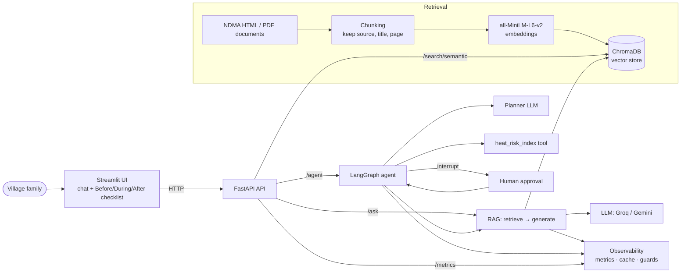

# AapdaMitra

[](https://github.com/KajalHonde/GenAI/actions/workflows/ci.yml)
[](https://www.python.org)
[](https://fastapi.tiangolo.com)

**AapdaMitra** ("disaster friend") is a retrieval-augmented assistant that turns
long, institution-facing NDMA guideline PDFs and short citizen pages into simple,
do's-and-don'ts advice for families — for floods, heatwaves and earthquakes.

> For a village near the Godavari River, Kopargaon, Maharashtra: a Gram Panchayat
> member who needs reliable, plain-language safety guidance before, during and
> after monsoon floods and the April–May heatwave.

---

## The problem

Families living near the Godavari need trustworthy guidance to prepare for
monsoon floods and extreme heat. The official material exists, but it is spread
across long PDFs meant for officials and terse web pages. People end up unsure
what to do *before*, *during* and *after* a hazard, and generic chatbots invent
safety steps that may be wrong or dangerous.

## What AapdaMitra does

- **Answers citizen questions with citations** drawn only from official NDMA
  sources, and **abstains ("I don't know.")** when the data cannot answer — it
  never invents safety instructions or fake forecasts.
- **Before / During / After checklist** in the Streamlit UI: tick boxes for the
  chosen hazard and print it for the village notice board.
- **A LangGraph agent** that plans which tool to use — RAG retrieval or a
  `heat_risk_index` calculator (Rothfusz "feels like" regression) — with a
  human-in-the-loop approval step before tools run.
- **Production guards**: per-request latency + token logging, an answer cache,
  input-length limits, and a prompt-injection guard. Live aggregates at `/metrics`.

## Architecture



The retrieval path prefers **citizen do's and don'ts** for family questions and
falls back to **guidelines** for official-sounding questions; it never produces
live warnings, because the underlying data is advisory, not a real-time feed.

## Tech stack

FastAPI · LangGraph · ChromaDB · sentence-transformers (MiniLM) · Groq / Gemini ·
Streamlit · pytest / ruff · Docker Compose · Render · GitHub Actions CI.

## Quickstart (local)

The app lives in [`Day  07`](Day%20%2007/). From that directory:

```bash
python -m pip install -r requirements-dev.txt
# put GROQ_API_KEY (and optionally GEMINI_API_KEY) in Day 06/.env
python -m app.index_documents     # build the Chroma index from documents/
uvicorn app.main:app --reload     # API at http://localhost:8000
streamlit run ui/app.py           # UI at http://localhost:8501
```

## Run with Docker

```bash
cd "Day  07"
docker compose up --build
# API: http://localhost:8000  ·  UI: http://localhost:8501  ·  Docs: http://localhost:8000/docs
```

See [`Day  07/README.md`](Day%20%2007/README.md) for the full operational notes
(Docker, Render blueprint, tests, and the auto-generated RAG evaluation table).

## API

| Method | Endpoint | Description |
|---|---|---|
| `GET`  | `/health` | Liveness check |
| `GET`  | `/search/semantic?q=` | Semantic search over indexed chunks |
| `POST` | `/ask` | Answer a question with citations (RAG) |
| `POST` | `/agent` | LangGraph agent (RAG + heat-index tool, with approval) |
| `GET`  | `/metrics` | Aggregated request metrics (latency, tokens, cache, blocks) |
| `GET`  | `/docs` | Interactive OpenAPI docs |

Interactive docs: <https://aapdamitra-api.onrender.com/docs>

## Results

### RAG evaluation (15 questions)

Two chunk-size / top-k configurations were evaluated against a 15-question set;
the agent must abstain on Q6 (a question the data cannot answer).

| Configuration | Chunk Size | Top-K | Score | Q6 Abstention |
|---|---:|---:|---:|---|
| **Config A (winner)** | 100 | 3 | 9/15 (60.0%) | PASS |
| Config B | 150 | 5 | 9/15 (60.0%) | PASS |

### Production benchmark (real Groq calls, default index)

| Request | Cached | Latency (ms) | Tokens |
|---|:--:|---:|---:|
| Q1 — what to do before a flood | no | 2592 | 1259 |
| Q2 — heatwave precautions | no | 1779 | 719 |
| Q3 — what to do during an earthquake | no | 1582 | 752 |
| Q4 — safe to drive through flooded roads | no | 1001 | 766 |
| Q1 (repeat) | **yes** | **0.2** | **0** |

Aggregated across 5 requests: **avg latency 1390 ms, p95 2429 ms, 3496 tokens,
1 cache hit**. The cache turns a ~1.4 s generation into a sub-millisecond lookup.

## Production notes

Measured on a local run against the default (chunk size 100, top-k 3) index
with Groq `openai/gpt-oss-120b`; reproduced with `python -m eval.bench_production`.

- **Latency logging**: every `/ask`, `/search/semantic` and `/agent` request
  records wall-clock latency; aggregates are exposed at `GET /metrics`.
- **Token logging**: `/ask` records prompt + completion tokens from the
  provider's usage response — 719–1259 tokens per answer in the run above
  (prompt 495–825, completion 151–434).
- **Cache**: answers are cached in memory (LRU, 128 entries, 10-minute TTL) keyed
  on the normalised question + top-k. A repeat question returned in **0.2 ms
  with 0 tokens** versus ~2.6 s / 1259 tokens for the cold call — roughly a
  13,000× speedup on the repeat.
- **Input limits**: questions are capped at 500 characters (`/ask`, `/agent`)
  and search queries at 200 characters; over-long input returns `422`.
  LLM output is capped at 1024 tokens.
- **Prompt-injection guard**: a pattern check refuses attempts such as
  *"ignore previous instructions"* or *"reveal your system prompt"* **before**
  the model is called, returning a fixed refusal and recording a `blocked`
  metric. No model tokens are spent on blocked requests.
- **Tests**: 39 pytest tests (records, search, `/health`, `/ask` with a fake
  LLM, the heat-index tool, cache, input limits, injection guard, metrics),
  `ruff check .` clean, CI runs ruff + pytest + docker build on every push.

## Demo

- **Live API (Render):** <https://aapdamitra-api.onrender.com/health> and
  **UI:** <https://aapdamitra-ui.onrender.com> — deployed from `render.yaml`
  on the free tier (the first request after idle may take ~30 s while the
  instance wakes and the embedding model loads).
- **Demo video:** _recording for Demo Day — replace this line with the
  published video link before the final demo._

## Data sources

1. NDMA Guidelines — <https://ndma.gov.in/en/guidelines>
2. Floods: Do's & Don'ts — <https://ndma.gov.in/en/floods-dos-donts>

## Resume bullets

See [`docs/resume.md`](docs/resume.md) for three resume-ready bullets.

## Repository layout

The project is built day-by-day as a learning build; the production app lives in
`Day  07/` (FastAPI + LangGraph + Chroma + Streamlit UI), with CI, Docker and
Render deployment configured at the repository root.

```
Day  07/
├── app/        # FastAPI API, RAG, LangGraph agent, tools, observability
├── ui/         # Streamlit chat + Before/During/After checklist
├── tests/      # 39 pytest tests
├── eval/       # RAG eval + production benchmark
└── documents/  # source NDMA HTML pages
.github/workflows/ci.yml   # ruff + pytest + docker build
render.yaml                # Render blueprint (API + UI)
```
